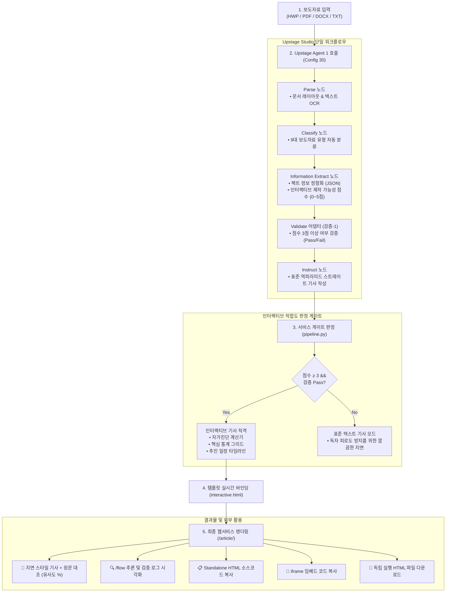

# 📰 press2article — 보도자료 to 기사 & 독자 참여형 인터랙티브 웹서비스

> **Upstage Studio AI 파이프라인 기반 지자체 보도자료 기사화 & 실시간 인터랙티브 컴포넌트 자동 생성 서비스**  
> 보도자료(HWP, HWPX, PDF, DOCX, TXT)를 입력하면 역피라미드 구조의 **신문 기사 초안**과 함께, 독자 맞춤형 **인터랙티브 웹 컴포넌트(자가진단 계산기, 타임라인, 통계 카드)**를 원클릭으로 추출하고 외부로 배포할 수 있습니다.

---

## ⚡ 팀원 빠른 시작 가이드 (Quick Start)

팀원이 이 레포지토리를 `git pull` 받은 후, 본인의 Upstage API 키만 넣으면 **즉시 웹 서비스를 실행**할 수 있습니다.

### 1. 저장소 클론 및 이동
```bash
git clone https://github.com/zzzaaanew/Hackathon_Service-Implementation.git
cd Hackathon_Service-Implementation
```

### 2. 가상환경 생성 및 의존성 패키지 설치
```bash
# 가상환경 생성 및 활성화 (Windows)
python -m venv .venv
.venv\Scripts\activate

# 가상환경 생성 및 활성화 (macOS / Linux)
python3 -m venv .venv
source .venv/bin/activate

# 필수 패키지 설치
pip install -r requirements.txt
```

### 3. 환경 변수 설정 (`.env`)
`.env.example` 파일을 복사하여 `.env`를 생성하고 본인의 API 키를 입력합니다.
```bash
# Windows
copy .env.example .env

# macOS / Linux
cp .env.example .env
```

`.env` 파일을 열고 본인의 API 키를 설정합니다:
```env
# 본인 Upstage 콘솔 API 키 (up_... 형식)
UPSTAGE_API_KEY=up_xxxxxxxxxxxxxxxxxxxxxxxxxxxx

# 워크플로우 1 에이전트 설정 (기본값 제공, 변경 필요 없음)
UPSTAGE_AGENT_ID=agt_GG3zVpMqhdZ6CshaSfg6Um
UPSTAGE_CONFIG_ID=cfg_Un9YoPTuJYUN7dchi9ozfQ
UPSTAGE_PROJECT_ID=proj_DRxifgzqyygzavzHqaZR3g

PORT=5001
HOST=127.0.0.1
```

### 4. 웹 서버 실행 및 접속
```bash
python app.py
```
서버가 실행되면 웹 브라우저에서 **`http://127.0.0.1:5001`** 에 접속합니다!

---

## 🏗 시스템 아키텍처 및 파이프라인 설계



---

## 💡 핵심 구현 및 기술적 의사결정

### 1. 단일 워크플로우(Workflow 1) 최적화 — 중복 호출 제거
* **기존 문제점**: 초기에 기사 초안 작성(1차) 후 별도의 2차 워크플로우를 호출하여 평가·생성하던 구조는 API 호출 지연으로 인해 **60~80초 이상의 심각한 레이턴시**가 발생했습니다.
* **해결책**: Upstage Studio **Config 30**의 단일 워크플로우 안에 `Information Extract`(팩트 추출 + 인터랙티브 가능성 점수 0~5점)와 `Validate 어댑터`(3점 이상 검증) 노드를 일원화했습니다.
* **효과**: 불필요한 2차 워크플로우를 완전 삭제하여 **응답 속도를 20초 안팎으로 대폭 단축**했습니다.

### 2. LLM 실시간 HTML 코딩 대신 [템플릿 바인딩 방식] 채택
* **선택 이유**:
  1. **안정성 (오류율 0%)**: LLM이 HTML/JS 전체를 실시간 타이핑하면 따옴표 깨짐, 태그 누락, 모바일 반응형 파괴, XSS 보안 취약점이 빈번합니다.
  2. **극적인 속도 개선**: LLM은 정형화된 JSON 팩트만 빠르게 추출하고, 검증된 반응형 템플릿(`interactive.html`)에 0.1초 만에 즉시 매핑합니다.
  3. **완전한 Standalone 독립 실행**: 생성된 인터랙티브 코드는 외부 프레임워크나 서버 의존성 없이 브라우저에서 단독으로 동작하므로, 타 언론사 CMS나 블로그에 즉시 붙여넣을 수 있습니다.

### 2-1. 시연용 보도자료 5건 전용 인터랙티브 (쇼케이스)
데모데이 시연용 보도자료 5건은 경향신문·조선일보 인터랙티브 기사 형식을 참고해 만든 전용 페이지로 연결됩니다. 일반 보도자료는 지금처럼 `interactive.html` 템플릿 바인딩을 씁니다.

| 시연 파일 | 전용 페이지 (`templates/showcase/`) | 형식 |
| --- | --- | --- |
| set02 청년 월세·전세보증료 지원 | `housing.html` | 조건을 넣으면 대상 여부와 금액이 나오는 맞춤 계산기 |
| set04 여름철 차량화재 통계 | `carfire.html` | 스크롤에 따라 그래픽이 바뀌는 데이터 스토리 |
| set16 보행환경 종합정비 5곳 선정 | `walk.html` | 선정 과정(18→11→5)과 지도 탐색 |
| set12 대경권 광역이음 출범 | `daegyeong.html` | 대상(청년·중장년·통근 노동자·기업)별 지원 탐색 |
| set11 지역의대 신설 | `medschool.html` | 정원 100석 그리드, 타임라인, Q&A 검색 |

* **판별 방식** (`showcase.py`): 원문에 건별 고유 문구가 모두 있으면 해당 건으로 봅니다. 원문을 못 읽었을 때만 파일명(`setNN`)으로 판별합니다.
* **수치**: 전용 페이지의 수치는 보도자료 원문과 사람이 직접 대조해 넣은 값입니다. 합계처럼 따로 계산한 값은 화면에 ‘계산’이라고 표시했습니다. 페이지 아래 ‘기사 전문’은 워크플로우가 그때 생성한 기사입니다.
* 외부 라이브러리 없이 HTML·CSS·JS와 SVG만 사용하므로 단독 HTML 다운로드·소스 복사·iframe 임베드가 그대로 동작합니다.

### 3. 인터랙티브 생성 판정 (5대 기준 0~5점) & 4단계 자동 검증
보도자료의 모든 내용을 억지로 인터랙티브로 만들면 독자의 피로도가 증가합니다. 5대 기준을 점수화하여 **점수 구간별 분기**와 **자동 검증**을 수행합니다.
1. **수치 (3개 이상)**: 금액·인원·비율 등 의미가 다른 숫자 *(날짜·전화번호 제외)*
2. **비교 (두 값 이상 비교)**: 전년 대비·지역별·제도 변경 전후·증감률·순위 포함
3. **장소 (2곳 이상)**: 지도에 찍을 수 있는 지명·시설·도로 *(기관 청사 제외)*
4. **시간 (3단계 이상)**: 일정표·절차(신청→심사→지급)·시점별 추이
5. **맞춤 (조건 + 결과)**: 나이·소득·거주지 등 조건에 따라 받을 금액·할 일이 명시

* **판정 기준**:
  * **3~5점 (`가능`)**: 지도·차트·타임라인·계산기 등 형식 자동 추천 (`4~5점 GREEN`, `3점 4점 미만 경고`)
  * **2점 (`검토 필요`)**: 기자 검토 후 제작 여부 결정 (강제 미리보기 지원)
  * **0~1점 (`불가`)**: 일반 텍스트 기사로 작성
* **자동 검증 (4단계)**: `1) 기사 생성` → `2) 유형 확인` → `3) 인터랙티브 가능(≥3점)` → `4) GREEN 조건(≥4점)`

---

## 🖥 화면 구성 및 주요 기능

| 페이지 URL | 기능 및 설명 |
|---|---|
| `/` | **보도자료 첨부 및 입력**: HWP, HWPX, PDF, DOCX, TXT 파일 드래그앤드롭 및 텍스트 직접 붙여넣기, 매체사 선택 |
| `/article/<id>` | **기사 보기 및 인터랙티브 프리뷰**: 신문 지면 스타일 기사, 원문 대조 형광펜·취소선(문장 사용률 %), 5대 평가 지표 뱃지, 실시간 자가진단 계산기, 타임라인, 소스코드 복사/다운로드 |
| `/interactive/<id>` | **독립형 인터랙티브 웹 전체화면**: 모바일/PC 반응형 전체화면 인터랙티브 뷰어 (상단에 원클릭 HTML 복사 버튼 탑재) |
| `/article/<id>/source-code` | **단독 HTML 소스코드 API**: 외부 웹사이트나 CMS에 그대로 붙여넣을 수 있는 순수 HTML 코드 반환 |
| `/article/<id>/download-interactive` | **HTML 파일 다운로드**: 오프라인이나 타 서버에서 바로 열리는 단일 `.html` 파일 다운로드 |
| `/flow/<id>` | **추론 및 파이프라인 시각화**: 업스테이지 노드별 실제 보낸 파일, 받은 JSON/텍스트, Validate 검증 결과, 게이트 판정 시각화 |
| `/eval` | **정답지 벤치마크 검증**: `eval/answers.csv` 정답지와 모델 예측값을 대조하여 정답률 및 채점 표 제공 |

---

## 📁 프로젝트 디렉터리 구조

```text
Hackathon_Service-Implementation/
├── app.py                     # Flask 웹 애플리케이션 라우트, HTML 소스 반환 및 다운로드
├── pipeline.py                # Upstage Studio Agent 1 연동, 팩트 파싱, 5대 기준 판정 엔진
├── hwp_reader.py              # 한글(HWP, HWPX) 바이너리 및 XML 자동 텍스트 추출 모듈
├── evaluate.py                # 정답지 벤치마크 자동 채점 스크립트
├── requirements.txt           # 필수 파이썬 패키지 목록
├── .env.example               # 팀원용 환경설정 템플릿 파일
├── .gitignore                 # .env, __pycache__ 등 비공개 파일 격리
├── eval/
│   ├── answers.csv            # 해커톤 검증용 기준 정답지
│   └── inputs/                # 테스트용 보도자료 파일 폴더
├── templates/
│   ├── base.html              # 헤더 마스트헤드 및 공통 레이아웃
│   ├── index.html             # 보도자료 입력 및 파일 첨부 화면
│   ├── article.html           # 신문 지면 스타일 기사 + 인터랙티브 위젯 + 소스코드 추출
│   ├── interactive.html       # 완전 독립 실행형(Standalone) 반응형 인터랙티브 웹 템플릿
│   ├── flow.html              # 파이프라인 단계별 입출력 추론 시각화 화면
│   ├── raw.html               # 에이전트 단계별 원본 출력 JSON/Markdown 뷰어
│   ├── eval.html              # 모델 성능 검증 시작 화면
│   └── eval_run.html          # 검증 채점 결과 표 화면
└── static/
    └── style.css              # 신문 지면 서체 및 인터랙티브 UI 스타일시트
```

---

## 🛠 기술 스택

* **Backend**: Python 3.10+, Flask, OpenAI Python SDK (Upstage API v2 호환)
* **AI Engine**: Upstage Studio Agent (v2/responses), Document Parse API, Solar LLM
* **Document Parser**: Python `olefile`, `zipfile`, `xml.sax` (HWP 5.0, HWPX, PDF, DOCX)
* **Frontend**: Vanilla HTML5, CSS3 (Modern Flex/Grid, Paper Print Stylesheet), JavaScript (ES6+)
